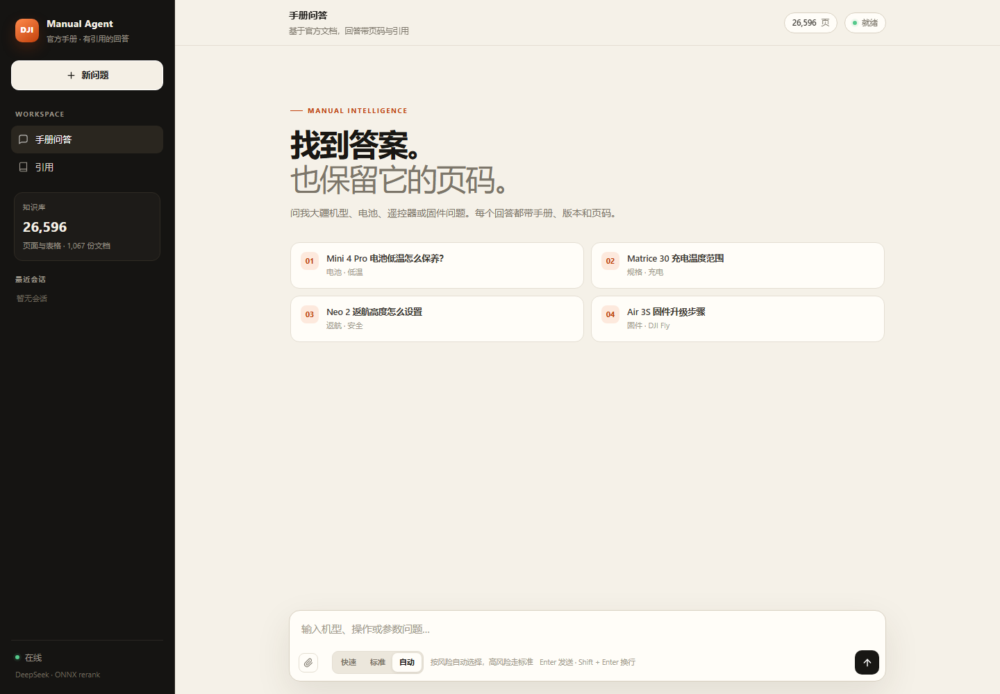
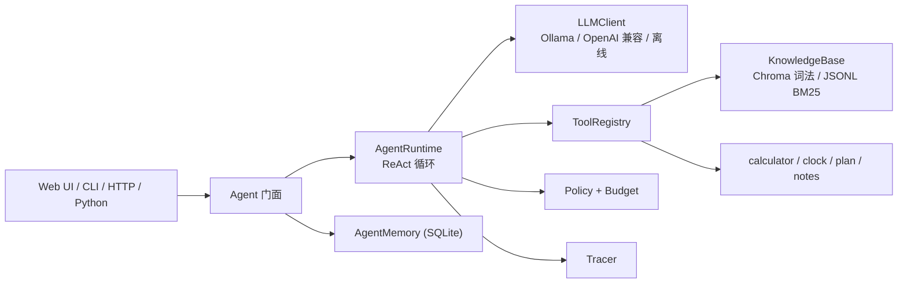

# DJI 手册 Agent

面向大疆（DJI）官方产品手册的**多步工具调用 Agent**。

它在原有「PDF 分块 → 向量库 → 多路检索 → 重排 → 生成」的 RAG 工程之上，增加了真正的 Agent 能力：
自主决策、工具调用、多轮检索、显式计划、长期记忆、预算/安全护栏、JSONL 追踪、端到端评测，以及 Web / CLI / HTTP / Python 四种入口。

> 一句话：**RAG 不再是整个应用，而是 Agent 手里的一件工具。**



## 可复现 Demo（推荐）

```bash
pip install -r requirements-demo.txt
cp .env.agent.example .env.agent   # 填 DEEPSEEK_API_KEY，可留空离线降级
python -m agent serve --port 8077 --config configs/agent.deepseek.yaml
# 打开 http://127.0.0.1:8077/remote
python scripts/smoke_demo.py
```

- [可复现 Demo 文档](docs/DEMO.md)
- [评测与坏例](docs/EVALUATION.md)
- [安全与多用户隔离](docs/SECURITY.md)
- [设计文章：为什么这样做](docs/DESIGN.md)
- [简历项目描述](docs/RESUME.md)
- [License：MIT（仅代码，DJI 手册/图片不在授权范围）](LICENSE)

当前视觉链路：`qwen3-vl-plus`（DashScope 原生 MaaS）+ 本地 OCR 兜底；`qwen-vl` 在当前网关不可用。

## 30 秒上手（无需 LLM、无需向量库）

```bash
pip install -r requirements.txt -r requirements-agent.txt
python -m agent demo
```

演示会走完完整的 Agent 循环：检索手册 → 读取 observation → 生成带 `[S1]` 引用的答案 → 写入 trace。
数据来自仓库自带的 `data/agent_demo_corpus.jsonl`（从三本官方用户手册抽取）。

```bash
# 单次任务（Ollama 不可用时自动降级为离线策略）
python -m agent run "Mavic 4 Pro 智能飞行电池低温下怎么保养？"

# 交互式多轮
python -m agent chat

# 评测
python -m agent eval --kb jsonl

# Web 界面 + HTTP API（同步 + SSE）
python -m agent serve --open

# HTTP API
python -m agent serve --port 8077
```

## Web 界面

`python -m agent serve --open` 会自动打开浏览器；前端由 FastAPI 同源托管在 `/`，无需 Node 构建、无外部 CDN。
如果本机没有 Ollama，服务会自动降级到离线策略；想跳过 3.7GB 向量库、秒开演示，可以先设置
`AGENT_KB_BACKEND=jsonl`。

```bash
# 快速演示：只用自带 JSONL 语料
set AGENT_KB_BACKEND=jsonl   # Windows PowerShell: $env:AGENT_KB_BACKEND="jsonl"
python -m agent serve --open
```

- **流式轨迹**：实时显示 Agent 的思考、工具调用、observation、预算与警告；
- **可追溯引用**：答案里的 `[S1]` 可点击，下方展示来源手册、页码、章节与 chunk；
- **运行面板**：状态、耗时、步数、工具次数、tokens、完整步骤与原始 JSON；
- **多会话**：浏览器 localStorage 保存历史，服务端 `session_id` + SQLite 记忆恢复上下文；
- **工具与健康**：侧边栏展示 7 个工具及 LLM/知识库健康状态；
- **深浅主题**、移动端适配、Markdown 安全渲染；
- **演示直达**：访问 `/?demo=1` 自动跑一个电池低温问题，`/?q=...` 可预填问题。

前端文件：`web/index.html`、`web/styles.css`、`web/app.js`（原生 HTML/CSS/JS）。

## 它比原来的 RAG 多了什么

| 能力 | 原 RAG | 现在的 Agent |
|------|--------|--------------|
| 检索 | 固定一次 | 按需多次、可换关键词、可核对 |
| 决策 | 固定流水线 | LLM 自主选择工具/结束 |
| 工具 | 无 | 手册检索、取回、计算、时间、计划、笔记 |
| 规划 | 无 | `update_plan` 显式 todo list |
| 记忆 | 无 | SQLite：运行记录 / 笔记 / 多轮对话 |
| 失败恢复 | 弱 | 工具失败、解析失败、LLM 重试、强制收尾 |
| 证据闸门 | 无 | 手册问题无检索证据时拒绝直答，自动 RAG 回退重答 |
| 引用校验 | 无 | 规范化 `[S1]`、检查数值/机型/逐句引用支持度，UI 显示 grounding 分数 |
| 语义复核 | 无 | 可选第二模型逐句判断引用是否支持 claim（DeepSeek 配置开启） |
| 机型过滤 | 无 | 从问题识别机型传给 `manual_search`，软过滤机型文档；索引元数据不足时回退全库 |
| 成本控制 | 无 | 步数 / 工具 / LLM / 时间四重预算 |
| 可观测性 | 日志 | JSONL trace + 回放 + 评测 |
| 入口 | Python 函数 | Web UI + CLI + HTTP(SSE) + Python API |

## 架构



一次运行会产出结构化 `AgentResult`：答案、引用、每一步的工具调用/observation、用量、状态与 warnings。
详见 **[docs/AGENT.md](docs/AGENT.md)**。

## 接真实 LLM

### DeepSeek 官方 API（OpenAI 兼容）

先在 [DeepSeek 开放平台](https://platform.deepseek.com/api_keys) 申请 API Key，然后：

```powershell
$env:DEEPSEEK_API_KEY="sk-..."
python -m agent run "Mavic 4 Pro 电池低温怎么保养？" --config configs/agent.deepseek.yaml

# Web 界面
python -m agent serve --open --config configs/agent.deepseek.yaml
```

也可以只通过环境变量切换（不用配置文件）：

```powershell
$env:AGENT_LLM_PROVIDER="deepseek"
$env:AGENT_LLM_MODEL="deepseek-flash"          # 或 deepseek-v4-pro
$env:AGENT_LLM_BASE_URL="https://api.deepseek.com"
$env:DEEPSEEK_API_KEY="sk-..."
python -m agent run "固件升级失败怎么办？"
```

当前 DeepSeek 官方模型为 `deepseek-flash` 与 `deepseek-v4-pro`，均支持 Tool Calls
（以 [官方模型页](https://api-docs.deepseek.com/zh-cn/quick_start/pricing) 为准）。
`configs/agent.deepseek.yaml` 默认使用 `tool_mode: native`；如果某个兼容网关不支持 `tools`，
把它改成 `text` 即可走本项目的 JSON 动作协议。

- `thinking: true` + `reasoning_effort: high` 能提升多步决策质量，但会增加延迟与 token；
  想更快可设为 `thinking: false` 或 `reasoning_effort: none`。
- 调试 API 时加 `--no-fallback-offline`，否则健康检查失败会自动降级到离线策略，容易误以为配置没生效。
- 不要把 Key 写进提交到 Git 的 YAML；优先用 `DEEPSEEK_API_KEY` / `AGENT_LLM_API_KEY` 环境变量。
- 也可以把 Key 写入仓库根目录的 `.env.agent`（已加入 `.gitignore`，启动时自动加载）：
  这样即使不带 `--config`，也会使用 `.env.agent` 里的 `AGENT_CONFIG` 指向的 DeepSeek 配置。
  模板见 `.env.agent.example`。

### 本地模型怎么选（本机 4GB 显存）

当前机器是 **RTX 3050 Ti Laptop（4GB VRAM）+ 16GB RAM**，本地模型能跑，但要接受质量/速度取舍：

| 模型 | 体积（Q4 左右） | 4GB 显存 | 建议 |
|------|----------------|----------|------|
| `qwen3.5:2b` | 2.7–3.1GB | 可放下 | 显存紧张/追求响应速度时用 |
| `qwen3.5:4b` | 3.3–4.0GB | 比较紧，可能少量 offload | **本机首选本地模型** |
| `qwen3.5:9b` | 6.6–7.6GB | 需要 CPU offload | 质量更好，但明显变慢 |
| `qwen3.5:27b` / `35b` | 17–22GB | 不适合 | 不建议在这台机器上跑 |
| `deepseek-r1:7b` | 约 4–5GB | 需要 offload | 推理强但话多、JSON 稳定性一般，不适合做主力 Agent |

```bash
ollama pull qwen3.5:4b
python -m agent run "Mavic 4 Pro 电池低温怎么保养？" --config configs/agent.local.yaml
python -m agent serve --open --config configs/agent.local.yaml
```

`configs/agent.local.yaml` 已针对 4GB 显存调低上下文和步数：

```yaml
llm:
  provider: ollama
  model: qwen3.5:4b
  tool_mode: native
  thinking: false       # 降低延迟
  num_ctx: 16384        # 不要一上来开 256K
```

如果 OOM 或明显卡顿，把 `model` 改成 `qwen3.5:2b`；如果更看重质量、能接受慢，
改成 `qwen3.5:9b`（Ollama 会自动把部分层放到 CPU）。

> 对这台机器，我的建议是：**日常用 DeepSeek 官方 API，离线/隐私场景用 Qwen3.5-4B 兜底**。
> 多步 Agent 一次任务会调用模型 2–6 次，4GB 显存下 4B 的质量和延迟都明显不如
> `deepseek-flash`；9B 虽然更强，但 offload 后体感会很慢。

### Ollama（本地）

```bash
ollama serve
ollama pull deepseek-r1:7b
python -m agent run "固件升级失败怎么办？"
```

### 其他 OpenAI 兼容服务（vLLM / 网关）

```powershell
$env:AGENT_LLM_PROVIDER="openai"
$env:AGENT_LLM_MODEL="Qwen/Qwen2-7B-Instruct-AWQ"
$env:AGENT_LLM_BASE_URL="http://localhost:8000/v1"
$env:AGENT_LLM_API_KEY="..."
python -m agent run "遥控器怎么对频？"
```

支持两种工具协议：

- `llm.tool_mode: text`：通用 JSON 协议，适配不支持 function calling 的本地模型；
- `llm.tool_mode: native`：原生 tool calling，适配 DeepSeek 官方 API、OpenAI、vLLM。

若 LLM 健康检查失败，CLI / `serve` 默认自动降级到离线确定性策略；`--no-fallback-offline` 可关闭。

## 常用命令

| 命令 | 说明 |
|------|------|
| `python -m agent demo` | 离线演示（无需 LLM） |
| `python -m agent run "问题"` | 单次任务 |
| `python -m agent chat` | 多轮交互 |
| `python -m agent eval --kb jsonl` | 评测工具/答案/引用 |
| `python -m agent tools` | 查看工具目录 |
| `python -m agent health` | 组件健康检查 |
| `python -m agent trace --list` | 查看运行轨迹 |
| `python -m agent config` | 打印生效配置 |
| `python -m agent serve --port 8077` | 启动 HTTP API 与 Web UI |
| `python -m pytest -q` | 运行测试套件 |

## 目录（Agent 部分）

```
agent/                 Agent 运行时、工具、知识库、记忆、追踪、评测、CLI、HTTP
web/                   Web UI（原生 HTML/CSS/JS，无构建步骤）
configs/agent.yaml     Agent 配置（YAML + AGENT_* 环境变量覆盖）
configs/agent.deepseek.yaml  DeepSeek 官方 API 示例配置
configs/agent.local.yaml     Qwen3.5-4B 本地示例（4GB 显存调优）
configs/agent.prod.yaml      vLLM / OpenAI 兼容生产示例
.env.agent.example           本地 Key 模板（.env.agent 已 gitignore）
data/agent_manual_kb.jsonl        最终知识库（26,596 条 = 页面 26,559 + 表格 37）
data/agent_manual_pages.jsonl     页面级手册库（26,559 页 / 1,067 文档）
data/agent_manual_tables.jsonl    表格记录（37 张，核心 PDF）
data/agent_manual_pages_pdf_core.jsonl  核心机型 PDF 逐页（756 页 / 12 本）
data/agent_manual_pages_pdf_extra.jsonl 大 PDF 并行池（1,135 页 / 20 本）
data/agent_manual_pages_pdf_rest.jsonl  其余机型并行池（6,036 页 / 284 本）
data/agent_manual_pages_from_chunks.jsonl  旧 chunk 页面兜底（27,651 页）
data/agent_demo_corpus.jsonl      离线演示语料（208 条，来自 3 本官方手册）
docs/AGENT.md          架构、协议、工具、记忆、安全、扩展
docs/assets/           Web UI 截图
scripts/build_pdf_pages.py      从核心 PDF 逐页构建
scripts/build_pdf_pool.py       大 PDF 并行子进程 + 超时 + chunk 兜底
scripts/build_page_corpus.py    从旧 chunk 按页重建
scripts/merge_page_corpora.py   合并 PDF 精读与 chunk 兜底
scripts/build_pdf_tables.py     从 PDF 抽取表格（Markdown + 行列 JSON）
scripts/build_table_pool.py     并行表格抽取
scripts/merge_table_corpus.py   页面 + 表格合并
scripts/build_demo_corpus.py    重新生成演示语料（支持 PDF / Chroma 两种来源）
tests/                 单元与集成测试（158）
run_agent.py           `python run_agent.py ...` 等价入口
```

## 重建页面级手册库

```powershell
# 1. 核心机型 PDF 逐页（用户手册/安全指引/产品信息）
python scripts/build_pdf_pages.py --include-types user_manual,safety,product_information `
  --max-size-mb 30 --max-pages 250 --output data/agent_manual_pages_pdf_core.jsonl

# 2. 大 PDF / 缺失机型并行池（每本独立子进程，超时自动兜底）
python scripts/build_pdf_pool.py --workers 4 --timeout 180 --max-pages 400 `
  --output data/agent_manual_pages_pdf_extra.jsonl

# 3. 其余可识别机型（跳过已精读 doc_id）
python scripts/build_pdf_pool.py --all-models --workers 6 --timeout 120 --max-pages 300 `
  --exclude-jsonl data/agent_manual_pages_pdf_core.jsonl `
  --exclude-jsonl data/agent_manual_pages_pdf_extra.jsonl `
  --output data/agent_manual_pages_pdf_rest.jsonl

# 4. 旧 chunk 按页兜底（只生成一次）
python scripts/build_page_corpus.py --output data/agent_manual_pages_from_chunks.jsonl

# 5. 合并页面，PDF 覆盖同 doc_id 的旧页面
python scripts/merge_page_corpora.py `
  --pdf-core data/agent_manual_pages_pdf_core.jsonl `
  --pdf-core data/agent_manual_pages_pdf_extra.jsonl `
  --pdf-core data/agent_manual_pages_pdf_rest.jsonl `
  --chunk-pages data/agent_manual_pages_from_chunks.jsonl

# 6. 表格抽取（当前 12 本核心 PDF，37 张表）
python scripts/build_table_pool.py `
  --from-jsonl data/agent_manual_pages_pdf_core.jsonl `
  --workers 6 --timeout 240 --output data/agent_manual_tables.jsonl

# 7. 页面 + 表格 → 最终知识库
python scripts/merge_table_corpus.py `
  --pages data/agent_manual_pages.jsonl `
  --tables data/agent_manual_tables.jsonl `
  --output data/agent_manual_kb.jsonl
```

生成的 `data/agent_manual_kb.jsonl` 被所有 `configs/agent*.yaml` 的
`knowledge.backend: jsonl` 使用；每条记录有页码、机型、版本、文档类型，
表格还有 `columns / rows / table_id`。

## 关键设计说明

1. **RAG 是工具，不是主流程**：`manual_search` 封装手册检索，Agent 可以多次调用、换词、核对。
2. **页面级索引优先**：新 `data/agent_manual_pages.jsonl` 按 PDF 页面生成，
   带 `model / version / page / doc_type / source`；核心机型由 PDF 逐页解析，
   其余文档由旧 chunk 按页合并兜底。BM25 直接检索页面，不再从 167 万碎 chunk 里拼答案。
   旧 `chroma_final` 使用 `precomputed` 嵌入，查询文本没有对应嵌入；保留它仅作历史对照。
3. **协议宽进严出**：模型可以输出 JSON、代码围栏、ReAct 文本；解析失败会纠错重试，预算耗尽会强制收尾。
4. **可治理**：工具白名单、风险等级、超时、重复调用拦截、observation 截断、四重预算。
5. **可回放**：每次运行写 `.agent/traces/<日期>/<trace_id>.jsonl`，包含全部决策与工具结果。
6. **可评测**：`agent/eval.py` 关注端到端行为（工具是否正确、答案是否命中、引用是否给出），
   而不是只看检索 Recall。

---

# 原 RAG 基础层（保留）

以下模块保持不变，仍可独立使用；Agent 通过工具层复用其数据与能力。

## 仓库结构（逻辑模块）

详细文件职责与依赖见 **[docs/MODULE_MAP.md](docs/MODULE_MAP.md)**。

简要分层：

1. **配置**：`config_center.py`、`configs/*.yaml`
2. **检索**：`query_enhancement.py` → `intent_classifier.py` → `filter_generator.py` → `retrieval_system.py` → `multi_path_retriever.py` → `reranker.py`
3. **上下文与流水线**：`context_builder.py`、`rag_pipeline.py`、`generation_pipeline.py`、`llm_generator.py`
4. **增强**：`dji_rag_runtime.py`
5. **数据**：`batch_pdf_processor.py`、`vector_db_system.py`、`run_vector_db.py` 及各类 `build_*.py`

## 环境

```bash
python -m venv .venv
.venv\Scripts\activate   # Windows
pip install -r requirements.txt
```

按需安装：`pyyaml`（配置中心）、`requests` / `beautifulsoup4`（`main.py` 抓 PDF）、`langchain-*`（仅运行 `dji_rag_qa.py` 时）、PDF 与 FAISS 相关依赖见各脚本头部说明与 `INSTALL_FAISS.md`、`VECTOR_DB_GUIDE.md` 等文档。

Agent 额外依赖见 `requirements-agent.txt`（FastAPI/uvicorn/pytest；核心运行时只复用已有依赖）。

## 运行入口示例

- 构建向量库：`python run_vector_db.py`（参见脚本内环境变量说明）
- 端到端检索测试：`python run_e2e_test.py` 或 `python debug_retrieve.py`
- 生成流水线：在业务代码中引用 `generation_pipeline`（见 `test_generation_pipeline.py`）
- Agent：`python -m agent demo` / `python -m agent run "..."`

## 大文件与版本控制

向量库目录、`embed_cache.npz`、`dji_chunks_final.jsonl`、`faiss_index.bin` 等体积较大，已列入 **`.gitignore`**。建议用网盘或对象存储分发数据，仓库只保留代码与小型配置/样例。

Agent 运行产物（`.agent/`、日志、SQLite）也已忽略；`data/agent_demo_corpus.jsonl` 作为小型演示数据保留。

## 打包分享（源码 + 文档）

在仓库根目录执行（生成 `dist/dji-rag-source-时间戳.zip`，排除常见大目录与二进制缓存）：

```powershell
powershell -ExecutionPolicy Bypass -File .\scripts\pack_source_release.ps1
```

将 `dist` 下 zip 上传至 GitHub Release、网盘或直接发送即可。

若使用 GitHub：新建仓库后推送代码（勿提交 `.gitignore` 中已忽略的大文件），再在 Release 中附上上述 zip 作为「完整源码包」。

## 文档索引

| 文档 | 内容 |
|------|------|
| [docs/AGENT.md](docs/AGENT.md) | Agent 架构、协议、工具、记忆、安全、扩展 |
| [docs/MODULE_MAP.md](docs/MODULE_MAP.md) | 模块划分与依赖 |
| [VECTOR_DB_GUIDE.md](VECTOR_DB_GUIDE.md) | 向量库使用 |
| [RETRIEVAL_SYSTEM_README.md](RETRIEVAL_SYSTEM_README.md) | 检索系统设计 |
| [RAG_RETRIEVAL_PART2_README.md](RAG_RETRIEVAL_PART2_README.md) | RAG 检索扩展说明 |
| [INSTALL_FAISS.md](INSTALL_FAISS.md) | FAISS 安装 |
