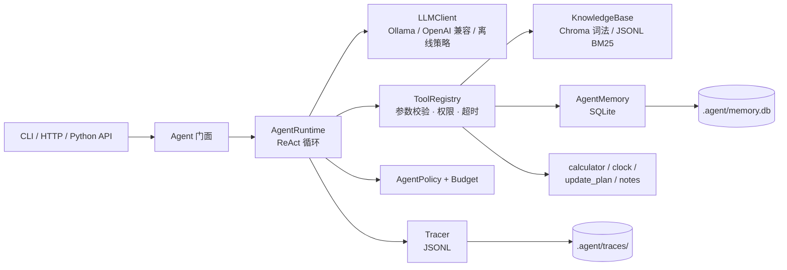
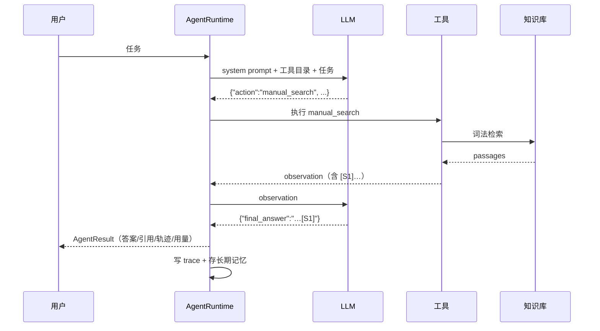
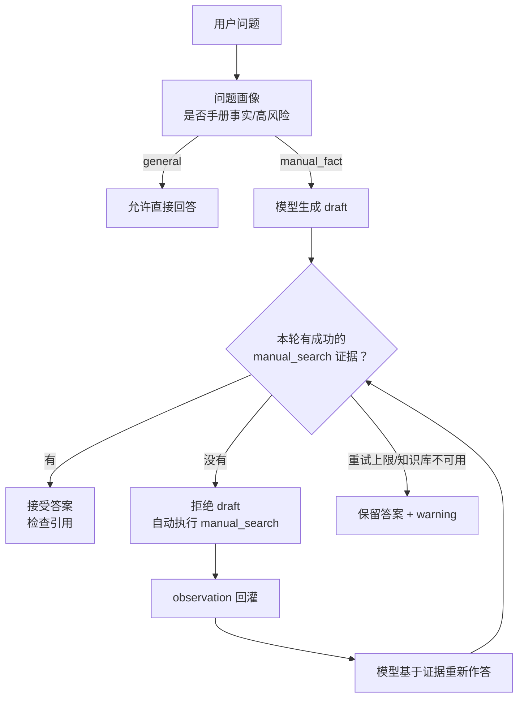
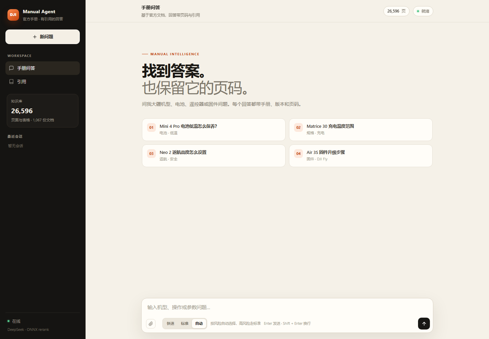

# DJI 手册 Agent 架构与使用指南

> 本文说明如何把原来的「单轮 RAG 流水线」升级为「多步工具调用 Agent」，
> 以及新架构的协议、工具、记忆、护栏、可观测性与扩展方式。

---

## 1. 从 RAG 到 Agent：到底变了什么

原来的系统是一条固定流水线：

```
query → 查询增强 → 意图分类 → 多路召回 → RRF → 重排 → 拼上下文 → LLM 生成 → 后处理
```

它只能「检索一次，生成一次」。一旦出现下面情况就会失败：

- 用户问题需要先查 A 再查 B（多跳）；
- 第一次检索词不好，需要换关键词重试；
- 需要计算、查时间、记笔记、对比多个机型；
- 检索结果互相矛盾，需要核对；
- 长任务需要规划、控制步数与成本。

Agent 的做法是把 RAG 降级成**一个工具**，外面套一个「决策—行动—观察」循环：

```
任务
  → LLM 决策（调用哪个工具 / 是否直接回答）
  → 执行工具（手册检索、计算、计划、笔记…）
  → observation 回灌
  → 再决策 …… 直到给出带引用的最终答案
```

| 能力 | 原 RAG | 现在的 Agent |
|------|--------|--------------|
| 检索次数 | 固定 1 次 | 按需多次、可换词 |
| 工具 | 无 | 7 个内置工具，可扩展 |
| 规划 | 无 | `update_plan` 显式计划 |
| 记忆 | 无 | SQLite：运行记录 / 笔记 / 多轮对话 |
| 失败恢复 | 基本没有 | 工具失败、解析失败、LLM 重试 |
| 成本控制 | 无 | 步数 / 工具 / LLM / 时间四重预算 |
| 可观测性 | 日志 | JSONL trace + 回放 + 评测 |
| 对外形态 | Python 函数 | CLI + HTTP(SSE) + Python API |

---

## 2. 架构总览



一次典型运行：



### 分层

| 层 | 目录/文件 | 职责 |
|----|-----------|------|
| 门面 | `agent/agent.py` | 装配 LLM、知识库、工具、记忆、策略 |
| 运行时 | `agent/runtime.py` | 多步循环、预算、错误恢复、引用聚合 |
| 决策 | `agent/llm.py`、`agent/prompt.py`、`agent/parser.py` | 模型协议、提示词、动作解析 |
| 工具 | `agent/tools/` | 注册表、内置工具、手册检索工具 |
| 知识 | `agent/knowledge.py` | 页面级 JSONL BM25 / Chroma 词法 / 自动降级 |
| 记忆 | `agent/memory.py` | SQLite 情节记忆 / 笔记 / 对话轮次 |
| 护栏 | `agent/policy.py` | 预算、工具白名单、风险等级、确认 |
| 观测 | `agent/trace.py` | JSONL trace、索引、回放渲染 |
| 评测 | `agent/eval.py` | 端到端用例：工具、答案、引用 |
| 接口 | `agent/cli.py`、`agent/server.py` | 命令行与 FastAPI |
| 离线 | `agent/offline.py` | 不依赖 LLM 的确定性策略（演示/CI） |

---

## 3. 一次运行的完整流程

1. **构建 system prompt**
   - 身份、当前时间、知识库说明；
   - 工具目录（名称、参数 JSON Schema、风险等级）；
   - 输出协议与引用规则。
2. **组装消息**
   - system + 最近多轮历史（按字符/轮数裁剪）+ 当前任务。
3. **调用 LLM**
   - `text` 模式：要求只输出一个 JSON 对象；
   - `native` 模式：传 OpenAI function calling schema，解析 `tool_calls`。
4. **解析动作**
   - 支持 JSON、代码围栏、尾逗号、ReAct 文本、纯文本兜底；
   - 无法解析 → 回灌纠错提示，连续失败达到上限则收尾。
5. **执行工具**
   - 参数按 JSON Schema 子集校验/温和纠错；
   - 权限、风险、超时、异常统一转成 `ok=False` 的 observation。
6. **回灌 observation**
   - 工具结果 + 引用编号；超过 `max_observation_chars` 时保留头尾。
7. **循环或收尾**
   - 模型给出 `final_answer` → 结束；
   - 预算耗尽 → 强制「禁止调用工具，仅基于现有观察作答」；
   - 仍失败 → 返回已检索信息的摘要（不会空手而归）。
8. **后处理**
   - 解析 `[Sx]` 引用，过滤未知编号；
   - 写 trace、存 episode/轮次；
   - 返回 `AgentResult`。

### 状态码

| status | 含义 |
|--------|------|
| `ok` | 正常给出最终答案 |
| `max_steps` | 步数上限，已尝试强制收尾 |
| `max_tool_calls` | 工具调用上限 |
| `max_llm_calls` | LLM 调用上限 |
| `timeout` | 墙钟超时 |
| `error` | LLM 不可用/连续解析失败等 |
| `no_answer` | 没有产生答案 |

---

### 证据闸门：LLM 先答，答不好再触发 RAG

这是对「先让 LLM 回答，答案有问题再 RAG」这条思路的工程化实现。关键点是：
**不要用 LLM 自评“我答得对不对”**，而是用确定性规则判断“这条回答有没有资格直接交付”。



实现位置：

- `agent/verifier.py`：`EvidenceGate.profile()` 用领域词/机型/高风险词判断问题画像；
  `EvidenceGate.check()` 检查答案是否有检索证据、引用是否未知；
- `agent/runtime.py`：模型给出 final 后先过闸门；没有证据就拒绝该 final，
  自动调用 `manual_search`，把 observation 回灌后继续循环；
- `agent/prompt.py`：`format_evidence_required()` 是知识库不可用/自动检索关闭时的纠正提示。

规则举例：

| 问题 | 画像 | 行为 |
|------|------|------|
| `Mavic 4 Pro 电池低温怎么保养？` | high | 必须先有手册证据 |
| `固件升级失败怎么办？` | high | 必须先有手册证据 |
| `请计算 (5000-249)/1000` | general | 允许直接调用计算器/回答 |
| `你好` | general | 允许直接回答 |
| `请问您的机型是哪一款？`（模型澄清） | — | 允许先反问，不强制检索 |

配置：

```yaml
agent:
  evidence_guard: true          # 开启证据闸门
  evidence_auto_search: true    # 无证据时自动执行 manual_search
  max_evidence_retries: 1       # 最多补一次证据
  grounding_check: true         # 逐句引用支持度校验
  claim_verifier: true          # 可选的第二模型逐句语义复核
  claim_verifier_max_claims: 12
```

配置之外，最终答案还会经过 `agent/grounding.py`：

- 把 `S1S2S5` / `S1、S2` 规范为 `[S1][S2][S5]`；
- 检查答案中的数值/单位是否出现在被引片段里；
- 检查句子提到的机型是否出现在引用来源里；
- 统计「支持度」（有引用的句子中被片段支持的比例）和「引用覆盖率」；
- 结果写入 `metadata.grounding`，Web UI 显示引用校验分数和问题列表。

如果 `claim_verifier: true`，还会调用一次**关闭 thinking 的低温度 verifier**，
把答案、问题、引用片段交给它逐条判断：

- `supported`：证据直接支持；
- `partial`：只支持一部分，或数值/条件有差异；
- `irrelevant`：引用片段与该 claim 主题无关（例如问高度却引用指南针校准）；
- `unsupported`：证据没有提到。

结果写入 `metadata.claim_verification`，UI 显示“语义复核 N 条”。
这一层能补上词面 grounding 抓不到的语义不相关问题，代价是多一次 LLM 调用。
DeepSeek / 生产配置默认开启，本地 4B 配置默认关闭。

### 机型过滤

运行时会从问题中识别机型（如 `Mavic 4 Pro`、`Air 3S`），写入
`ToolContext.requested_model`，`manual_search` 优先按该机型检索：

- `agent/tools/rag.py`：把机型传给知识库，并对结果做软匹配
  （`model` / `doc_id` / `title` 任一处包含即可）；
- `agent/knowledge.py`：Chroma 的精确 `where={"model": ...}` 查不到时回退到无过滤，
  避免“元数据写法不同”导致 0 结果；
- 结果写入 `metadata.requested_model`，grounding 也会检查机型是否与引用来源一致。

注意：页面库已带具体机型；旧 Chroma 的 `model` 元数据仍是系列级（如 `DJI Mavic Series`），
如果切回 Chroma 后端，仍只能做软过滤。要严格按机型隔离，应继续使用页面级 JSONL。

边界：

- 它防的是**无证据直接作答**，不是判断答案事实一定正确；
- 有证据但答案仍可能不完整/引用错误，运行时只做引用编号校验与 warning；
- 真正的“答案质量校验”可以再接一个 verifier LLM 或规则校验器，
  但会多一次模型调用，当前默认用确定性规则控制成本。

## 4. 模型协议

### 4.1 文本协议（默认，适配 DeepSeek-R1 等本地模型）

调用工具：

```json
{"thought": "需要查电池低温保养", "action": "manual_search", "action_input": {"query": "智能飞行电池 低温 保养", "top_k": 4}}
```

最终回答：

```json
{"thought": "证据足够", "final_answer": "低温下应先预热电池……[S1]", "citations": ["S1"]}
```

规则：

- 每次只输出一个 JSON 对象，不要 Markdown 围栏；
- `action_input` 必须是对象；
- 引用编号只能来自 observation 中出现过的 `[Sx]`；
- 不允许编造手册内容/页码。

解析器兼容：代码围栏、前后解释文字、尾逗号、`Action:/Action Input:`、`Final Answer:`、纯文本兜底（可配置关闭）。

### 4.2 原生 function calling

`llm.tool_mode: native` 时，运行时把工具声明转成 OpenAI schema 传给后端，
并处理 assistant `tool_calls` / tool 消息。适合 vLLM、OpenAI、DeepSeek 等支持工具调用的模型。

---

## 5. 工具系统

| 工具 | 风险 | 作用 |
|------|------|------|
| `manual_search` | safe | 检索手册，返回带 `[Sx]` 的片段 |
| `manual_fetch` | safe | 按 `chunk_id` 取回完整片段 |
| `calculator` | safe | AST 安全求值，禁止属性/导入/任意调用 |
| `clock` | safe | 带时区当前时间 |
| `update_plan` | safe | 维护 2-12 步计划（todo list） |
| `save_note` | moderate | 写入长期记忆 |
| `recall_notes` | safe | 检索长期记忆 |

工具声明示例：

```python
from agent.tools import Tool, ToolSpec, ToolContext, ToolRegistry
from agent.types import ToolResult

class ManualCountTool(Tool):
    spec = ToolSpec(
        name="manual_count",
        description="统计某机型手册片段数量",
        parameters={
            "type": "object",
            "properties": {"model": {"type": "string", "description": "机型名"}},
            "required": ["model"],
        },
        risk="safe",
        tags=["knowledge"],
    )

    def run(self, ctx: ToolContext, model: str) -> ToolResult:
        return ToolResult(ok=True, content=f"{model}: 123 条片段")
```

注册：

```python
agent.tools.register(ManualCountTool())
# 注意：system prompt 在 Agent 构造时生成；新增工具后需重建 Agent，
# 或直接构造新的 AgentRuntime。
```

### 安全边界

- `calculator` 只允许数字、四则运算、幂、少量数学函数；拒绝 `__import__`、属性访问、任意函数调用。
- 工具按 `risk` 分级；`risky` 默认拒绝，需要 `tools.allow_risky`；
- 工具白名单：`tools.enabled` + `AgentPolicy.allowed_tools`；
- 工具超时：默认 30s（`tools.timeout`）；
- 工具异常不会中断 Agent，而是变成 `ok=False` 的 observation，让模型自行调整；
- 相同工具+参数的重复调用会被拦截，避免死循环；
- observation 截断，防止上下文爆炸。

---

## 6. 知识库设计（重要）

当前默认后端是 **页面级 JSONL + BM25**：

1. **PDF 精读页面**：核心机型手册按 PDF 页抽取，保留 `model / version / page / doc_type / source`；
2. **旧 chunk 兜底**：其余文档用旧 167 万 chunk 按 `doc_id + page` 合并、清洗；
3. **合并**：PDF 精读覆盖同 `doc_id` 的旧页面，BM25 对 `source_kind=pdf` 加权。

原项目 `chroma_final` 使用 `precomputed` 嵌入：只有 chunk 的向量，没有 query 的嵌入模型，
语义通道实际是随机向量。现在它只保留作历史对照，默认配置不再使用。

```yaml
knowledge:
  backend: jsonl
  jsonl_path: data/agent_manual_kb.jsonl
  top_k: 4
  max_passage_chars: 1200
```

当前知识库规模：**26,596 条 = 26,559 页面 + 37 张表格**，1,067 文档，约 4,900 万字符。
其中 **316 本可识别机型手册由 PDF 逐页精读（7,927 页）**，其余由旧 chunk 页面兜底。

PDF 处理按文件大小和解析状态路由：

- 普通 PDF：`pypdf` 顺序精读；
- 大 PDF / 缺失机型：`build_pdf_pool.py` 每本独立子进程、6 并发、单本超时；
- 超时或失败：不产出 PDF 页，合并时保留同 `doc_id` 的 chunk 页面；
- 表格：`build_pdf_tables.py` 用 pdfplumber 抽取，独立 `type=table` 记录；
- 扫描页：预留 OCR 分支（当前环境无 Tesseract，暂用 chunk 兜底）。

查询词提取会优先保留英文型号（`Mavic`、`Pro`），再用领域词表把中文切成名词短语，
例如：

```
智能飞行电池在低温环境下如何保养？
→ ["智能飞行电池", "低温环境", "保养"]
```

机型过滤：

- 从问题识别 `Mavic 4 Pro` / `Air 3S` 等型号，写入 `requested_model`；
- BM25 先按 `passage.model` 过滤，精确型号不存在时允许同系列兜底；
- 页面记录带具体机型，避免旧 Chroma 的 `DJI Mavic Series` 系列级元数据导致串机型。

### 重建页面库

```bash
# 1) 核心机型 PDF 逐页
python scripts/build_pdf_pages.py --include-types user_manual,safety,product_information \
  --max-size-mb 30 --max-pages 250 --output data/agent_manual_pages_pdf_core.jsonl

# 2) 大 PDF / 缺失机型并行池
python scripts/build_pdf_pool.py --workers 4 --timeout 180 --max-pages 400 \
  --output data/agent_manual_pages_pdf_extra.jsonl

# 3) 其余可识别机型
python scripts/build_pdf_pool.py --all-models --workers 6 --timeout 120 --max-pages 300 \
  --exclude-jsonl data/agent_manual_pages_pdf_core.jsonl \
  --exclude-jsonl data/agent_manual_pages_pdf_extra.jsonl \
  --output data/agent_manual_pages_pdf_rest.jsonl

# 4) 旧 chunk 按页兜底
python scripts/build_page_corpus.py --output data/agent_manual_pages_from_chunks.jsonl

# 5) 合并
python scripts/merge_page_corpora.py \
  --pdf-core data/agent_manual_pages_pdf_core.jsonl \
  --pdf-core data/agent_manual_pages_pdf_extra.jsonl \
  --pdf-core data/agent_manual_pages_pdf_rest.jsonl \
  --chunk-pages data/agent_manual_pages_from_chunks.jsonl
```

> PDF 精读库优先；超过 30MB / 250 页的多语言合集由并行池尝试，超时则由 chunk 页面兜底。
> 如果后续接入 OCR，可把扫描页也纳入。

### 演示语料

仓库仍保留 `data/agent_demo_corpus.jsonl`（约 200 条、从三本官方用户手册抽取），
用于快速 demo/CI；真实使用走 `data/agent_manual_pages.jsonl`。

```bash
pip install pypdf cryptography --target .vendor
python scripts/build_demo_corpus.py
```

---

## 7. 记忆

| 类型 | 存储 | 生命周期 | 用途 |
|------|------|----------|------|
| 工作记忆 | 运行时 `messages` | 单次运行 | 思考/工具/观察 |
| 情节记忆 | `episodes` 表 | 长期 | 每次任务、答案、步数、引用、用量 |
| 语义记忆 | `notes` 表 | 长期 | 用户偏好、结论、待办 |
| 对话记忆 | `turns` 表 | 长期 | 多轮会话（同一 `session_id`） |

SQLite 文件默认 `.agent/memory.db`（已 gitignore）。写入失败会自动降级为「无记忆」，不影响主流程。

多轮示例：

```python
agent.ask("我的机器是 Mavic 4 Pro", session_id="user-1")
agent.ask("那电池低温怎么保养？", session_id="user-1")  # 自动恢复最近轮次
```

---

## 8. 预算、追踪与评测

### 预算

```yaml
agent:
  max_steps: 8          # 一次 LLM 决策算一步
  max_tool_calls: 12
  max_llm_calls: 10
  max_seconds: 180
  max_consecutive_errors: 3
```

预算耗尽后运行时会要求模型「禁止再调工具，只基于现有 observation 收尾」；
仍失败则返回已检索信息摘要，并标记 `status` / `forced_final`。

### Trace

每次运行写一个 JSONL：

```
.agent/traces/2026-11-18/tr_20261118_160416_44b495.jsonl
```

包含 `run_start`、`llm_response`、`tool_call`、`tool_result`、`warning`、`final`、`run_end`。
查看：

```bash
python -m agent trace --list
python -m agent trace --show tr_20261118_160416_44b495
```

### 评测

```bash
python -m agent eval --kb jsonl
python -m agent eval --kb chroma --output .agent/eval_report.json
```

指标：通过率、工具准确率、答案命中率、引用覆盖率、平均耗时。
默认用例覆盖「电池低温保养」「固件升级失败」「算术计算」三类。

---

## 9. 快速开始

### 9.1 离线演示（无需 LLM / 无需向量库）

```bash
pip install -r requirements.txt -r requirements-agent.txt
python -m agent demo
```

它会用内置确定性策略走完完整的 Agent 循环（检索→观察→作答），并给出引用与 trace 路径。

### 9.2 接真实 LLM

#### DeepSeek 官方 API

DeepSeek 官方 API 与 OpenAI Chat Completions 兼容：

- Base URL：`https://api.deepseek.com`
- 当前模型：`deepseek-flash`、`deepseek-v4-pro`（均支持 Tool Calls）
- API Key：在 [platform.deepseek.com](https://platform.deepseek.com/api_keys) 申请

```powershell
$env:DEEPSEEK_API_KEY="sk-..."
python -m agent run "Mavic 4 Pro 电池低温怎么保养？" --config configs/agent.deepseek.yaml
python -m agent serve --open --config configs/agent.deepseek.yaml
```

或者环境变量：

```powershell
$env:AGENT_LLM_PROVIDER="deepseek"
$env:AGENT_LLM_MODEL="deepseek-flash"
$env:AGENT_LLM_BASE_URL="https://api.deepseek.com"
$env:DEEPSEEK_API_KEY="sk-..."
python -m agent run "固件升级失败怎么办？"
```

`configs/agent.deepseek.yaml` 默认：

```yaml
llm:
  provider: deepseek
  model: deepseek-flash
  base_url: https://api.deepseek.com
  api_key: ${DEEPSEEK_API_KEY:-}
  thinking: true
  reasoning_effort: high
  tool_mode: native
```

- DeepSeek 当前的 `thinking` 默认开启；调低 `reasoning_effort` 或 `thinking: false` 可降低延迟与 token。
- 如果使用第三方兼容网关且不支持 `tools`，把 `tool_mode` 改为 `text`。
- 调试时加 `--no-fallback-offline`，避免健康检查失败后自动切到离线策略而误判。
- 不要把 API Key 写入提交到 Git 的配置文件。
- 可以把 Key 写入仓库根目录的 `.env.agent`（已 gitignore，自动加载），模板见 `.env.agent.example`；
  在其中设置 `AGENT_CONFIG=configs/agent.deepseek.yaml` 后，不带 `--config` 也默认走 DeepSeek。

#### Ollama 本地模型

```bash
ollama serve
ollama pull qwen3.5:4b
python -m agent run "固件升级失败怎么办？" --config configs/agent.local.yaml
```

本机 4GB 显存建议 `qwen3.5:4b`（或 OOM 时 `2b`），配置已经调低 `num_ctx: 16384`、
`thinking: false` 和 `max_steps: 6`。`qwen3.5:9b` 质量更好，但 4GB 显存会大量 offload 到 CPU；
`27b/35b` 不适合这台机器。

如果使用旧的 DeepSeek-R1 Ollama 模型：

```bash
ollama pull deepseek-r1:7b
python -m agent run "固件升级失败怎么办？"
```

#### OpenAI 兼容（vLLM / 网关）

```powershell
$env:AGENT_LLM_PROVIDER="openai"
$env:AGENT_LLM_MODEL="Qwen/Qwen2-7B-Instruct-AWQ"
$env:AGENT_LLM_BASE_URL="http://localhost:8000/v1"
$env:AGENT_LLM_API_KEY="..."
python -m agent run "固件升级失败怎么办？"
```

如果健康检查失败，CLI 默认会自动降级到离线策略（`--no-fallback-offline` 可关闭）。

### 9.3 交互式

```bash
python -m agent chat
```

支持 `/tools`、`/health`、`/plan`、`/clear`、`/session`、`/exit`。

### 9.4 HTTP API

```bash
python -m agent serve --host 127.0.0.1 --port 8077
# 或 uvicorn agent.server:app --port 8077
```

| 方法 | 路径 | 说明 |
|------|------|------|
| GET | `/` | Web 界面（`web/index.html`） |
| GET | `/static/*` | 前端静态资源 |
| GET | `/healthz` | 组件健康检查 |
| GET | `/v1/tools` | 工具目录 |
| GET | `/v1/config` | 生效配置（api_key 脱敏） |
| GET | `/v1/traces` | 最近运行 |
| POST | `/v1/agent/run` | 同步执行 `{"task": "...", "session_id": "...", "history": [...]}` |
| POST | `/v1/agent/stream` | SSE 事件流 |

SSE 的 `event:` 是事件类型（`run_start` / `llm_response` / `tool_call` / `tool_result` /
`warning` / `budget` / `final` / `run_end` / `result` / `error`），`data:` 是该事件的业务
payload JSON；最后一个 `result` 事件携带完整 `AgentResult`，前端无需再发同步请求。

> HTTP 服务默认无鉴权，仅建议本地或内网使用；生产部署请在前面加网关鉴权与限流。

```bash
curl -X POST http://127.0.0.1:8077/v1/agent/run ^
  -H "Content-Type: application/json" ^
  -d "{\"task\":\"智能飞行电池低温怎么保养？\"}"
```

### 9.5 Web 界面

```bash
python -m agent serve --open
# 自动打开 http://127.0.0.1:8077/

# 无向量库 / 秒开演示
set AGENT_KB_BACKEND=jsonl
python -m agent serve --open
```

> `serve` 在 LLM 健康检查失败时会自动降级到离线策略（`--no-fallback-offline` 可关闭），
> 因此没有 Ollama 也能直接使用 Web UI。



当前公网/交互页面是 `web/remote.html`，由 FastAPI 同源托管，零构建、无外部 CDN：

- 浅色编辑风布局，深色侧边栏；
- fast / normal / auto 三种模式，默认自动按风险路由；
- 异步任务 + 进度状态，适配公网隧道；
- 页面级 `[S1]` 引用；
- 图片上传缩略图 + 发送后聊天气泡显示；
- Qwen3-VL 图片观察 + RapidOCR 文字兜底；
- 最近会话与多用户 session 隔离。

旧的 `web/index.html`（深色三栏运行轨迹）仍保留为本地调试入口，但不再是默认展示页。

### 9.6 Python API

```python
from agent import Agent

with Agent.from_config("configs/agent.yaml") as agent:
    result = agent.ask("Mavic 4 Pro 电池低温保养")
    print(result.answer)
    for citation in result.citations:
        print(citation.ref, citation.label())
    print(result.usage.to_dict())

    for event in agent.stream("固件升级失败怎么办？"):
        print(event.type, event.payload)
```

---

## 10. 配置

主配置：`configs/agent.yaml`；DeepSeek 示例：`configs/agent.deepseek.yaml`；生产示例：`configs/agent.prod.yaml`。
优先级：默认值 < YAML < 环境变量。

| 环境变量 | 作用 |
|----------|------|
| `AGENT_CONFIG` | 配置文件路径 |
| `AGENT_ENV_FILE` | 本地环境文件路径，默认 `.env.agent` |
| `AGENT_LLM_PROVIDER` | `ollama` / `openai` / `deepseek` / `vllm` / `offline` |
| `AGENT_LLM_MODEL`、`AGENT_LLM_BASE_URL`、`AGENT_LLM_API_KEY` | LLM 连接 |
| `DEEPSEEK_API_KEY` | provider 为 `deepseek` 时自动读取 |
| `OPENAI_API_KEY` | provider 为 `openai` 时自动读取 |
| `AGENT_TOOL_MODE` | `text` / `native` |
| `AGENT_LLM_THINKING` | 思考模式：`true` / `false`（DeepSeek / Qwen3.5） |
| `AGENT_LLM_REASONING_EFFORT` | DeepSeek 思考强度：`none` / `low` / `high` / `max` |
| `AGENT_LLM_NUM_CTX` | Ollama 上下文窗口，例如 `16384` |
| `AGENT_KB_BACKEND` | `auto` / `chroma` / `jsonl` / `none` |
| `AGENT_CHROMA_PATH`、`AGENT_JSONL_PATH` | 知识库路径 |
| `AGENT_MEMORY_DB`、`AGENT_MEMORY_ENABLED` | 长期记忆 |
| `AGENT_TRACE_DIR`、`AGENT_TRACE_ENABLED` | 追踪 |
| `AGENT_MAX_STEPS`、`AGENT_MAX_TOOL_CALLS`、`AGENT_MAX_SECONDS` | 预算 |
| `AGENT_ALLOW_RISKY` | 是否允许高风险工具 |
| `AGENT_EVIDENCE_GUARD` | 是否开启证据闸门：`true` / `false` |
| `AGENT_EVIDENCE_AUTO_SEARCH` | 无证据时是否自动执行 `manual_search` |
| `AGENT_MAX_EVIDENCE_RETRIES` | RAG 回退重答次数上限 |
| `AGENT_GROUNDING_CHECK` | 是否开启逐句引用支持度校验 |
| `AGENT_CLAIM_VERIFIER` | 是否开启第二模型逐句语义复核 |
| `AGENT_CLAIM_VERIFIER_MAX_CLAIMS` | verifier 最多检查多少条 claim |

YAML 支持 `${VAR}` 与 `${VAR:-default}` 展开。

---

## 11. 与原有 RAG 代码的关系

- **保留**：`retrieval_system.py`、`multi_path_retriever.py`、`reranker.py`、
  `context_builder.py`、`rag_pipeline.py`、`generation_pipeline.py`、`llm_generator.py`
  等原模块不变，仍可单独使用。
- **新增**：`agent/` 包在其上提供运行时、工具、记忆、追踪、评测。
- **为什么 `manual_search` 不直接调用 `RAGRetrievalPipeline`**：
  预计算嵌入无法编码查询文本，语义通道实际是随机向量。Agent 改用 Chroma 词法检索，
  等接入真实 embedding 模型后，可在 `agent/knowledge.py` 增加
  `PipelineKnowledgeBase` 并保持工具接口不变。

---

## 12. 目录结构

```
agent/
  __init__.py         公开 API
  __main__.py         python -m agent
  agent.py            Agent 门面
  runtime.py          ReAct 循环
  types.py            Message / ToolCall / ToolResult / AgentResult
  errors.py           异常体系
  config.py           YAML + 环境变量配置
  prompt.py           系统提示 / observation / 纠正
  parser.py           动作解析 / 引用编号提取
  verifier.py         问题画像 / 证据闸门
  grounding.py        引用规范化 / 逐句 grounding 校验
  claim_verifier.py   逐句语义复核（可选第二模型）
  llm.py              Ollama / OpenAI 兼容 / 脚本化
  offline.py          离线确定性策略
  knowledge.py        Chroma 词法 + JSONL BM25
  memory.py           SQLite 记忆
  policy.py           预算 / 权限 / 确认
  trace.py            JSONL 追踪
  eval.py             评测
  cli.py              命令行
  server.py           FastAPI（含 Web UI 托管）
  tools/
    base.py           Tool / ToolSpec / ToolContext / ToolRegistry
    builtin.py        calculator / clock / plan / notes
    rag.py            manual_search / manual_fetch

web/
  index.html          三栏布局 / 欢迎页 / 设置弹窗
  styles.css          深色与浅色主题 / 响应式 / 流式轨迹
  app.js              SSE 消费 / Markdown / 引用联动 / 会话持久化
  favicon.svg

configs/agent.yaml
data/agent_demo_corpus.jsonl
docs/AGENT.md
docs/assets/          Web UI 截图
scripts/build_demo_corpus.py
tests/                单元与集成测试（158）
```

---

## 13. 下一步可扩展方向

1. **真正的语义检索**：接入 bge-m3 / text-embedding-3 等 query embedding，恢复语义通道并做混合检索。
2. **PDF 摄取工具**：让 Agent 能按需读取本地 PDF、抽取页面并引用。
3. **多 Agent**：Planner / Retriever / Reviewer 分工，或并行工具调用。
4. **MCP 工具接入**：把外部工具（网页、数据库、工单系统）挂到 `ToolRegistry`。
5. **更强的答案校验**：当前 `agent/grounding.py` 已做引用格式、数值、机型、逐句词面支持度检查；
   下一步可加 claim 抽取 + verifier LLM，判断“引用是否真的推出这句话”。
6. **流式 token**：当前流式是事件级（工具/步骤），可增加 token 级 SSE。
7. **权限沙箱**：为文件/网络/代码执行类工具增加独立进程与资源限制。

---

## 14. 参考的高星文档问答项目

> 以下不是 DJI 专用项目，而是截至 2026-11 在 GitHub 上高星的文档问答/RAG 项目；
> 它们的产品手册场景与 DJI 手册问答高度相似。

| 项目 | Stars | 值得借鉴的做法 |
|------|------:|----------------|
| [Dify](https://github.com/langgenius/dify) | 161k | Agentic workflow + RAG pipeline，把检索、生成、评测拆成可编排节点 |
| [RAGFlow](https://github.com/infiniflow/ragflow) | 94k | 深度文档解析、模板化 chunk、chunk 可视化、多轮检索、grounded citations |
| [AnythingLLM](https://github.com/Mintplex-Labs/anything-llm) | 68k | 文档 workspace、source citations、私有化部署 |
| [LlamaIndex](https://github.com/run-llama/llama_index) | 53k | `CitationQueryEngine`：编号 source、行内引用、无有用来源时明确说明 |
| [WeKnora](https://github.com/Tencent/WeKnora) | 37k | 混合检索、parent-child chunk、引用跳转到原文段落、chunk 编辑/回滚 |
| [Onyx](https://github.com/onyx-dot-app/onyx) | 33k | 企业搜索、ground truth documents、权限与上下文层 |
| [Haystack](https://github.com/deepset-ai/haystack) | 27k | 生产级 RAG pipeline 与 evaluation 组件 |
| [MaxKB](https://github.com/1Panel-dev/MaxKB) | 23k | 企业知识库、RAG pipeline、workflow、MCP |
| [DocsGPT](https://github.com/arc53/DocsGPT) | 18k | 每个回答引用文档；guardrails 拦截 ungrounded answers |
| [RAGAS](https://github.com/explodinggradients/ragas) | 16k | faithfulness、context precision/recall、response relevancy 等评测指标 |
| [QAnything](https://github.com/netease-youdao/QAnything) | 14k | 两阶段检索 + rerank，解决大规模知识库检索退化；PDF 溯源 |
| [Azure Search OpenAI Demo](https://github.com/Azure-Samples/azure-search-openai-demo) | 7.8k | 答案同时渲染 citations 与 thought process；带 evaluation / safety evaluation |
| [LlamaIndex CitationQueryEngine 文档](https://developers.llamaindex.ai/python/examples/workflow/citation_query_engine/) | — | “只基于 source 回答；每个答案至少一个引用；没有有用来源时说明” |

共性结论：

1. **文档解析/chunk 是第一优先级**：PDF 版式、表格、页眉页脚、跨页段落决定检索质量；
   高星项目都提供 chunk 预览/编辑/回滚，而不是把 PDF 直接切成固定长度。
2. **混合检索 + rerank**：单向量检索在数据量大时会退化；QAnything 明确用两阶段检索，
   WeKnora 用 hybrid search。
3. **引用是生成契约**：不是“答案后面附几个链接”，而是每个 claim 绑定 source；
   LlamaIndex 的 citation prompt 明确要求“只 cite 你实际引用的 source”。
4. **grounding/guardrails**：DocsGPT 直接拦截 ungrounded answers；RAGFlow 强调
   grounded citations；Azure demo 把 thought process 和 citations 一起展示。
5. **评测是闭环**：RAGAS 的 faithfulness / context precision / context recall 是业界通用指标；
   没有评测集的“引用看起来很多”不可信。
6. **原文跳转**：WeKnora/QAnything 支持从答案跳到原文段落/PDF 预览；
   只显示 `[S1]` 但看不到原文，用户无法判断引用是否支持结论。

对本项目的直接启示：

- 当前 Chroma 索引的 chunk 偏碎、元数据弱，是“答案跨机型/引用不相关”的根因之一；
  应优先重建 page/section-aware 的语料，而不是继续调 prompt。
- `agent/grounding.py` 只能做轻量校验；真正的语义支持判断仍需要 verifier LLM 或 claim 抽取。
- 需要把“机型/版本”作为检索过滤条件，而不是让模型在多本手册之间自由拼接。
