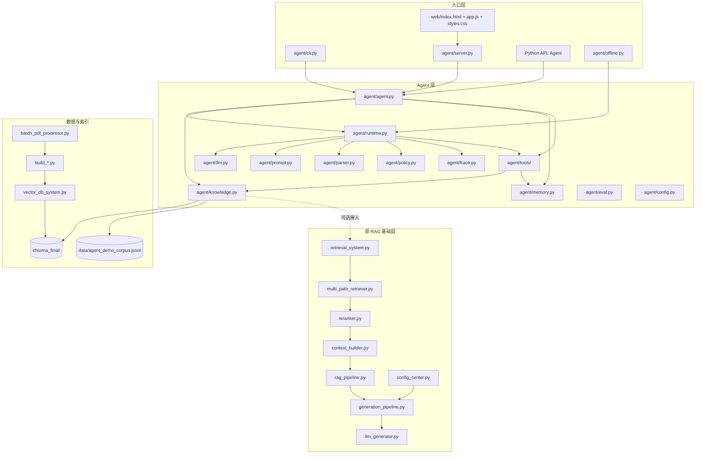

# 代码模块划分说明

本文档描述仓库内各模块的分层与职责。项目已从「单轮 RAG 流水线」升级为
「Agent + RAG 工具」，因此分为 **Agent 层** 与 **原 RAG 基础层** 两大部分。

## 架构总览

## 0. Agent 层

| 文件 | 说明 |
|------|------|
| `agent/agent.py` | Agent 门面：装配 LLM / 知识库 / 工具 / 记忆 / 策略；`ask`、`stream` |
| `agent/runtime.py` | ReAct 多步循环：调用模型、解析动作、执行工具、回灌 observation、预算与收尾 |
| `agent/types.py` | 公共数据契约：`Message`、`ToolCall`、`ToolResult`、`Citation`、`AgentStep`、`AgentResult` |
| `agent/errors.py` | 异常体系（LLM / Tool / Policy / Budget / KnowledgeBase） |
| `agent/config.py` | Agent YAML 配置 + `AGENT_*` 环境变量覆盖与校验 |
| `agent/prompt.py` | 系统提示、工具目录渲染、observation 格式化、强制收尾提示、历史裁剪 |
| `agent/parser.py` | 模型动作解析（JSON / 围栏 / ReAct / 纯文本兜底）与引用提取 |
| `agent/llm.py` | Ollama、OpenAI 兼容、脚本化客户端；统一 `complete()` 接口 |
| `agent/offline.py` | 离线确定性策略（检索→必要时改写→抽取式作答），用于演示/CI/降级 |
| `agent/knowledge.py` | 知识库：Chroma 词法检索、JSONL BM25、自动降级、查询词提取 |
| `agent/memory.py` | SQLite 长期记忆：episodes / notes / turns |
| `agent/policy.py` | 预算、工具白名单、风险等级、人工确认 |
| `agent/trace.py` | JSONL 追踪、运行索引、读取与渲染 |
| `agent/eval.py` | 端到端评测用例与指标 |
| `agent/cli.py` | 命令行：run / chat / demo / eval / tools / health / trace / config / serve |
| `agent/server.py` | FastAPI：Web UI 托管、健康检查、工具目录、同步运行、SSE 流式 |
| `agent/tools/base.py` | `Tool`、`ToolSpec`、`ToolContext`、`ToolRegistry`、参数校验与执行 |
| `agent/tools/builtin.py` | `calculator`、`clock`、`update_plan`、`save_note`、`recall_notes` |
| `agent/tools/rag.py` | `manual_search`、`manual_fetch`（把知识库封装为工具） |

## 1. 入口层

| 入口 | 说明 |
|------|------|
| `web/index.html` | Web 界面结构：侧边栏、对话区、运行轨迹面板、设置 |
| `web/styles.css` | 深/浅主题、三栏布局、响应式、流式轨迹样式 |
| `web/app.js` | 原生 JS：SSE 消费、Markdown 渲染、引用联动、会话持久化、设置 |
| `python -m agent serve --open` | 启动 API 并打开 Web UI（同源 `/`） |
| `agent/cli.py` | 命令行入口 |
| `agent/server.py` | FastAPI 入口 |
| `from agent import Agent` | Python API |

## 2. 原 RAG 配置层

| 文件 / 目录 | 说明 |
|-------------|------|
| `config_center.py` | 统一加载 YAML、校验与日志初始化 |
| `configs/dev.yaml` `configs/test.yaml` `configs/prod.yaml` | RAG 多环境配置 |
| `configs/agent.yaml` | Agent 配置（与 RAG 配置解耦） |
| `configs/agent.deepseek.yaml` | DeepSeek 官方 API 示例（native tool calls / thinking） |
| `configs/agent.local.yaml` | Qwen3.5-4B 本地示例（4GB 显存调优：num_ctx/thinking） |
| `configs/agent.prod.yaml` | vLLM / OpenAI 兼容生产示例 |

## 3. 查询理解与检索准备（RAG 基础层）

| 文件 | 说明 |
|------|------|
| `query_enhancement.py` | 查询清洗、纠错与扩展 |
| `intent_classifier.py` | 一级/二级意图（规则 + 可选 LLM） |
| `filter_generator.py` | 由意图生成 Chroma 元数据过滤条件 |
| `retrieval_system.py` | 整合上述能力，产出 `RetrievalContext` 并执行向量检索 |

## 4. 多路召回与精排（RAG 基础层）

| 文件 | 说明 |
|------|------|
| `multi_path_retriever.py` | 语义 / 关键词 / 元数据等多通道与 RRF 融合 |
| `reranker.py` | 重排序与阈值过滤 |

## 5. 上下文与流水线（RAG 基础层）

| 文件 | 说明 |
|------|------|
| `context_builder.py` | Chunk 预处理、Markdown 上下文组装、提示词模板、输出校验 |
| `rag_pipeline.py` | 检索端到端流水线（至 Prompt / 生成前上下文） |
| `generation_pipeline.py` | 在 RAG 之上叠加生成、审查与后处理 |
| `llm_generator.py` | 对接 Ollama / vLLM 等后端 |

> 这一层目前不被 Agent 直接 import；它仍可独立运行，也可作为
> `agent/knowledge.py` 的可选后端（见 `PipelineKnowledgeBase` 的扩展点）。

## 6. 运行时增强（RAG 基础层）

| 文件 | 说明 |
|------|------|
| `dji_rag_runtime.py` | 评估、磁盘/内存缓存、批量任务 |

## 7. 数据与索引构建

| 文件 | 说明 |
|------|------|
| `batch_pdf_processor.py` | PDF 解析、分块、写出 JSONL |
| `vector_db_system.py` | Chroma 写入、嵌入模型管理、质量校验 |
| `run_vector_db.py` | 调用 `vector_db_system` 的 CLI 入口 |
| `build_vector_db_final.py` | 基于预计算 npz 构建 Chroma |
| `build_chroma_optimized.py` | 大规模 Chroma 写入优化 |
| `build_simple.py` | 小规模快速验证构建 |
| `build_faiss_fixed.py` / `build_faiss_gpu.py` | FAISS 索引构建（可选路径） |
| `scripts/build_demo_corpus.py` | 从 PDF / Chroma 生成 Agent 离线演示语料 |

## 8. 独立脚本与旧版示例

| 文件 | 说明 |
|------|------|
| `main.py` | 从网页抓取 PDF 到 `data/dji_manuals`（与 RAG 流水线独立） |
| `download_modal.py` | 从镜像下载 SentenceTransformer 至 `mini_model` |
| `dji_rag_qa.py` | 基于 LangChain + Ollama 的简化 RAG 示例 |
| `debug_retrieve.py` / `run_e2e_test.py` | 检索与流水线调试脚本 |
| `check_data.py` / `check_ids.py` | 从 jsonl / npz 抽样检查数据 |

> 这些根目录脚本会在导入时加载大向量库，因此 `pytest.ini` 只收集 `tests/`。

## 9. 测试

| 文件 | 说明 |
|------|------|
| `tests/test_runtime.py` | 多步循环、预算、重复拦截、原生调用、追踪 |
| `tests/test_parser.py` | 各种模型输出形态的解析 |
| `tests/test_tools.py` | 计算器安全、参数校验、权限、超时、计划、笔记 |
| `tests/test_knowledge.py` | 分词、查询词、BM25、Chroma 可选冒烟 |
| `tests/test_memory.py` | SQLite 记忆与持久化 |
| `tests/test_agent_integration.py` | 离线策略端到端、事件流、会话记忆 |
| `tests/test_eval.py` | 评测框架 |
| `tests/test_cli.py` / `tests/test_server.py` | CLI、HTTP API 与 Web 静态资源 |
| `tests/test_config.py` | 配置与环境变量 |
| 根目录 `test_*.py` | 原 RAG 单元测试/集成测试（不属于 Agent 测试集） |

## 依赖关系要点

- `agent/` 不依赖 `rag_pipeline.py` / `generation_pipeline.py`，避免把 Agent 与旧流水线绑死；
  RAG 能力通过 `manual_search` 工具以「知识库后端」方式接入。
- `agent/knowledge.py` 直接读取 `chroma_final` 集合，不经过 `vector_db_system`，
  以减少耦合；原 `vector_db_system` 仍是构建/校验向量库的入口。
- `agent/agent.py` 是唯一装配点；`runtime.py` 不关心具体 LLM/工具/知识库实现。
- 原 RAG 层保持单向：检索 → 上下文 → 生成；Agent 在其外部增加决策循环。
- 删除的遗留文件：`build_vector_db.py`（损坏的 LangChain 片段）、`chotm_db.py`（重复脚本）。
